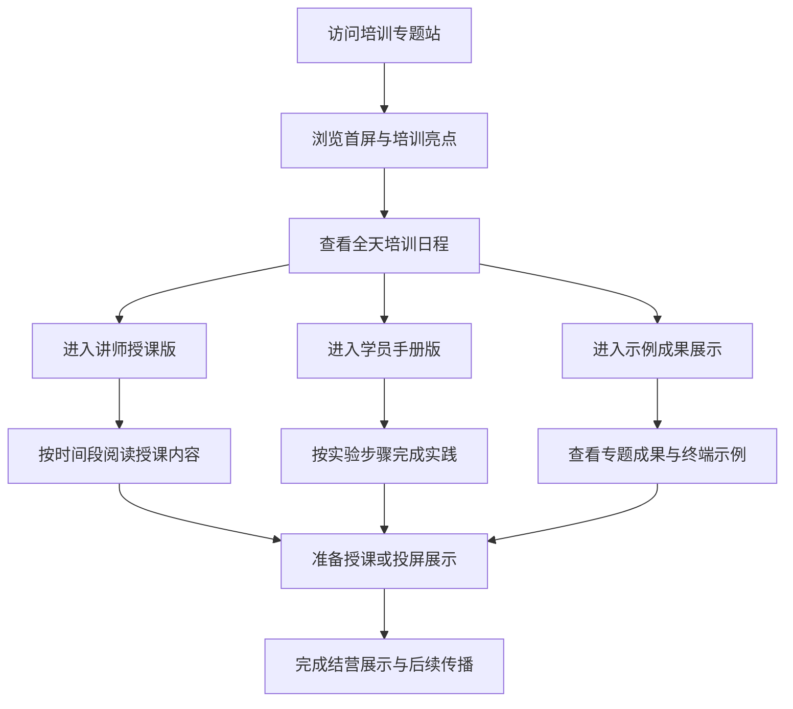

## 1. 产品概述
这是一个面向 RT-Thread 培训活动的单页展示网站，用于完整呈现培训日程、讲师授课版内容、学员培训手册版内容和专题实践示例成果。
- 主要目标是将原始培训安排升级为可在线浏览、便于传播、适合投屏展示且支持后续持续维护的培训专题网页。
- 目标用户包括培训组织者、讲师、参训学员及需要快速了解课程体系的合作伙伴。

## 2. 核心功能

### 2.1 功能模块
1. **首页总览**：品牌头图、培训定位、核心亮点、日程概览、快速入口。
2. **讲师授课版**：按照培训时间轴展示讲师讲稿、教学目标、课堂互动与收尾话术。
3. **学员手册版**：按照实验与专题实践模块展示目标、步骤、预期结果、成果要求。
4. **示例成果展示**：集中展示各专题的预期运行结果、终端日志示例与交付物说明。
5. **结营与后续学习**：展示成果验收方式、学习路径与部署/分享信息。

### 2.2 页面详情
| 页面名称 | 模块名称 | 功能描述 |
|-----------|-------------|---------------------|
| 首页 | 首屏视觉区 | 展示培训名称、定位文案、日期感、行动按钮，建立活动气质与信息入口 |
| 首页 | 培训亮点区 | 用卡片概述培训目标、适合人群、课程收益、输出成果 |
| 首页 | 日程总览区 | 以时间轴或双栏表格方式展示全天培训安排 |
| 首页 | 讲师授课版区 | 逐时段展开讲师版内容，支持锚点导航与快速跳转 |
| 首页 | 学员手册版区 | 按实验手册结构展示步骤、注意事项、预期结果 |
| 首页 | 示例成果区 | 用专题卡片展示 FOC、电机控制、OpenMV、LVGL、AI、双核通信等成果示例 |
| 首页 | 结营区 | 展示成果提交要求、学习建议、站点部署说明 |

## 3. 核心流程
访问者进入首页后，先在首屏快速理解培训主题与价值，再查看全天日程。随后根据自身身份选择进入“讲师授课版”或“学员手册版”阅读详细内容，也可以直接跳到“示例成果展示”查看各专题的预期交付效果。培训组织者可将此页面作为活动官网、宣讲页、投屏页或资料汇总入口使用。

## 4. 用户界面设计
### 4.1 设计风格
- 主色调：深海军蓝、青蓝霓虹、冷白文字，延续培训海报的科技感与专业感。
- 辅助色：浅青色高光、柔和银灰分隔线、少量暖色用于结果与提示。
- 按钮风格：半透明描边按钮与高亮主按钮结合，强调“进入讲师版”“查看手册”这类行为。
- 字体风格：标题使用有现代工业感的中文标题字体，正文使用清晰的中文无衬线字体，确保长文阅读舒适。
- 布局风格：桌面端采用左侧锚点导航 + 右侧内容流布局；关键区域配合时间轴、信息卡片、成果日志块。
- 图标建议：使用线性风格图标，避免花哨插画，突出工程培训和技术实战属性。

### 4.2 页面设计概览
| 页面名称 | 模块名称 | UI 元素 |
|-----------|-------------|-------------|
| 首页 | 首屏视觉区 | 大标题、副标题、三项亮点标签、CTA 按钮、科技背景纹理、轻微发光动画 |
| 首页 | 培训亮点区 | 四宫格卡片、短说明、数字化标签、悬浮反馈 |
| 首页 | 日程总览区 | 左右双栏时间表、滚动高亮、分段标题、当前时段视觉强调 |
| 首页 | 讲师授课版区 | 粘性子导航、章节卡片、目标/话术/互动问题/收尾小节结构 |
| 首页 | 学员手册版区 | 实验编号、步骤列表、终端代码块、通过标准提示卡 |
| 首页 | 示例成果区 | 专题成果卡、日志终端样式、标签筛选或分组展示 |
| 首页 | 结营区 | 清单式总结、部署说明、页脚信息 |

### 4.3 响应式设计
- 采用桌面优先设计，适合培训现场大屏、投影和电脑端浏览。
- 平板和手机端自动折叠为纵向内容流，并将锚点导航转为顶部横向滚动标签。
- 长篇内容区需要保证移动端阅读舒适，控制每行字数并增加段落留白。
- 按钮和锚点导航需支持触摸操作。
