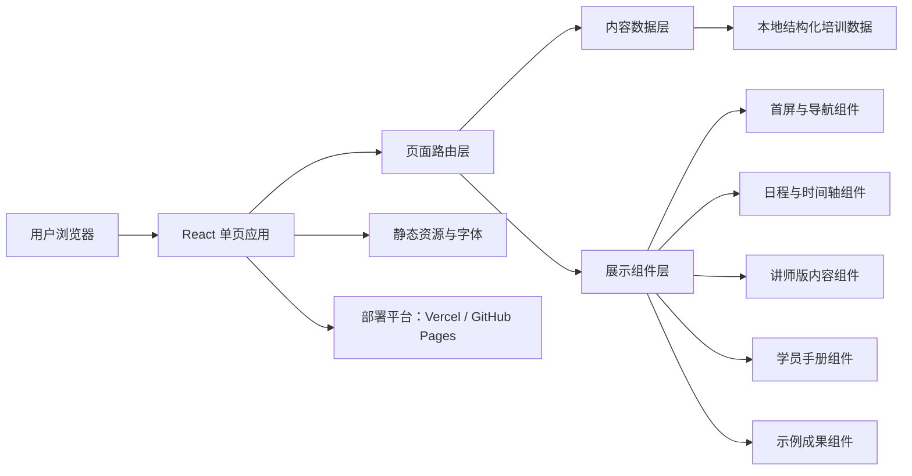
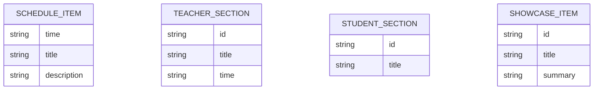

## 1. 架构设计
该站点定位为纯前端静态专题站，不依赖后端服务，所有内容以内置数据驱动页面渲染，优先保证部署简单、加载稳定、维护直观，并兼容 Vercel 与 GitHub Pages。



## 2. 技术说明
- 前端：React 18 + TypeScript + Vite
- 样式方案：Tailwind CSS 3 + 自定义 CSS 变量
- 构建工具：Vite
- 内容组织：本地 TypeScript 常量数据文件驱动，减少硬编码散落
- 动画方案：CSS 动画 + 轻量滚动显隐效果
- 后端：无
- 数据库：无
- 部署方式：默认静态导出，可部署到 Vercel 或 GitHub Pages

## 3. 路由定义
| 路由 | 用途 |
|-------|---------|
| / | 培训专题首页，包含日程、讲师授课版、学员手册版、示例成果展示 |

## 4. API 定义
本项目为纯静态站点，无外部 API。页面内容通过本地结构化数据组织。

### 4.1 内容数据类型定义
```ts
type ScheduleItem = {
  time: string;
  title: string;
  description?: string;
};

type TeacherSection = {
  id: string;
  title: string;
  time: string;
  goals: string[];
  script: string[];
  highlights: string[];
  demo?: string[];
};

type StudentSection = {
  id: string;
  title: string;
  target: string[];
  steps: string[];
  expectedResult?: string[];
  requirements?: string[];
};

type ShowcaseItem = {
  id: string;
  title: string;
  tags: string[];
  summary: string;
  terminalOutput?: string[];
};
```

## 5. 服务端架构图
本项目无独立服务端架构，使用静态文件部署。

## 6. 数据模型
### 6.1 数据模型定义


### 6.2 数据组织说明
- `schedule.ts`：存放日程总览数据。
- `teacherContent.ts`：存放讲师授课版内容。
- `studentManual.ts`：存放学员手册版内容。
- `showcase.ts`：存放专题成果与终端日志示例。
- 所有页面组件均从数据文件读取内容，便于后续扩展成更多期培训站点。

## 7. 实现要点
- 采用单页长滚动结构，结合锚点导航，适合内容密集型专题展示。
- 使用统一设计 Token 管理颜色、阴影、边框和间距，保证科技感视觉一致性。
- 首页首屏保留“RT-Thread 培训”视觉气质，融入时间线与网格背景呼应原始海报。
- 组件拆分需覆盖：首屏、导航、概览卡片、日程表、章节内容卡、终端日志卡、页脚。
- 为 GitHub Pages 兼容性，避免依赖服务端重写；若使用子路径部署，需配置 `base`。
- 为 Vercel 兼容性，保持纯静态构建输出，不引入需要 Node 服务端的运行逻辑。
